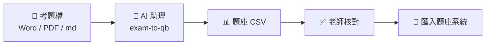

# QB 題庫轉換

> 🏆 本專案「AI 題庫自動轉換 exam-to-qb」榮獲大仁科技大學 115 年度
> **第四屆校務創新創意實踐典範競賽　B 類特優**（2026 年 11 月）

| 我是… | 請看 | 需要什麼 |
|-------|------|----------|
| 🟢 想先了解這是什麼 | [一、這個專案在做什麼？](#一這個專案在做什麼) | 不用準備 |
| 🔵 一般教師，用瀏覽器操作 | [二、網頁版操作](#二網頁版操作) | AI 帳號，**不用寫程式** |
| 🟣 會用終端機或 VS Code | [三、CLI 與 VS Code 操作](#三cli-與-vs-code-操作) | Python、終端機 |
| ⚙️ 維護這個專案 | [附錄：維護與格式](#附錄維護與格式) | Git |

---

# 一、這個專案在做什麼？

> 🟢 **所有人**｜1 分鐘看懂

**把「老師手上的考題檔」變成「題庫系統吃得下的題庫檔」。**



### 你只要做三件事

| 步驟 | 動作 |
|:--:|------|
| 1️⃣ | 準備考題檔 |
| 2️⃣ | 跟 AI 說「請把這份考題轉成題庫 CSV」 |
| 3️⃣ | 核對後，把 CSV 匯入題庫系統 |

### 它會幫你處理的雜事

- 認出題型：是非、單選、複選、填充、問答
- 拆好題目、選項、答案、解說，排成題庫系統要的 27 欄格式
- 編碼一律 UTF-8，可另附 Big5 版給舊系統
- 可依章節標題填「類別」
- 擋下答案缺漏、答案編號超過選項數等格式錯誤（Gemini 網頁版除外）

> 格式正確不代表答案正確，**匯入前一定要與原稿核對**。

### 先看看成果

| 檔案 | 內容 |
|------|------|
| [`sample.docx`](https://github.com/RelerChenTajen/Tools_QB/raw/main/sample.docx) | 範例考題（資訊安全，9 題，五種題型） |
| [`sample.csv`](sample.csv) | 轉換成果 |
| [`sample_big5.csv`](sample_big5.csv) | 轉換成果的 Big5 版 |

---

# 二、網頁版操作

> 🔵 **一般教師**｜只要瀏覽器和 AI 帳號，不用寫程式

### 第 1 步：選一個 AI

| | Claude 技能 | ChatGPT 私人外掛 | ChatGPT 附件 | Gemini 技能 |
|---|---|---|---|---|
| 適合 | 重要考試 | Plus，常用 | Plus，偶爾用 | 免費使用 |
| 事前準備 | 安裝一次 | 建立一次 | 不用 | 安裝一次 |
| 每次附上 | 考題 | 考題 | 考題與 ZIP | 考題 |
| 已實測的帳號 | 付費帳號 | Plus | Plus | 個人 Google 帳號（滿 18 歲） |
| 尚未實測的帳號 | 免費帳號（官方說明可用） | 其他方案 | 免費與其他方案 | 學校帳號（尚未開放技能） |
| 程式檢查格式 | 有 | 有 | 有 | 沒有，要自己核對 |
| Big5 版 | 可產生（未留實測紀錄） | ✅ 已實測可匯入 | 可產生（未留實測紀錄） | 用記事本另存 ANSI（未實測） |
| 與標準成果比對 | 只差第 8 題 2 個空白 | 逐位元相同 | 逐位元相同 | 各格內容相同 |

四種做法都已實測可匯入題庫系統（UTF-8 版，2026-11-25）。

### 第 2 步：下載並安裝

| AI | 下載（**不要解壓縮**） | 安裝步驟 |
|----|------------------------|----------|
| Claude | [`exam-to-qb.zip`](https://github.com/RelerChenTajen/Tools_QB/raw/main/web/dist/exam-to-qb.zip) | [Claude 安裝與操作](web/claude-web.md) |
| ChatGPT | [`exam-to-qb.zip`](https://github.com/RelerChenTajen/Tools_QB/raw/main/web/dist/exam-to-qb.zip) | [ChatGPT 安裝與操作](web/chatgpt-web.md) |
| Gemini | [`exam-to-qb-gemini.zip`](https://github.com/RelerChenTajen/Tools_QB/raw/main/web/dist/exam-to-qb-gemini.zip) | [Gemini 安裝與操作](web/gemini-web.md) |

不要用 GitHub 的「Download ZIP」，那是整個專案，不是安裝檔。

### 第 3 步：附上考題，說一句話

第一次請先用 [`sample.docx`](https://github.com/RelerChenTajen/Tools_QB/raw/main/sample.docx) 練習。

**Claude**
```
請使用 exam-to-qb 技能，把附件轉成題庫 CSV，類別填「資訊安全」，並產生 Big5 版。
```

**ChatGPT 私人外掛**：在 Work 輸入 `@` 選「考題轉題庫 CSV」，再輸入
```
請將上傳的考題轉成 27 欄題庫 CSV，類別填「資訊安全」。請實際執行 build.py，並提供 UTF-8 無 BOM 與 Big5（CP950）兩個版本的下載檔。
```

**ChatGPT 附件**：另附 `exam-to-qb.zip`，再輸入
```
請解壓縮 exam-to-qb.zip，閱讀 SKILL.md，依其流程把考題檔轉成題庫 CSV。
類別填「資訊安全」，並產生 Big5 版。
請實際執行 build.py 產生檔案；若無法執行 Python，請直接告訴我，不要用聊天文字代替。
```

**Gemini**：輸入 `@` 選 `exam-to-qb`，再輸入
```
請把附件轉成題庫 CSV，類別：資訊安全
```

### 第 4 步：核對後匯入

1. 用記事本開啟 CSV，第一列應以 `version: 4` 開頭。不要用 Excel 開啟後直接存檔。
2. 練習時，與[範例對照表](web/README.md#範例對照表)比對；正式考題請與原稿逐題核對。
3. 依[匯入前檢查](web/README.md#匯入前檢查)確認後，匯入題庫系統。

| 結果不對時 | 處理 |
|------------|------|
| Claude | 提示詞寫明「請使用 exam-to-qb 技能」，仍不對就刪除技能重新上傳 |
| ChatGPT 私人外掛 | 外掛裡的檔案可能被改寫，用 Plugin Creator 重新放入 ZIP，要求原封不動 |
| Gemini | 刪除技能重新建立 |

> 未經授權的正式考題、學生個資、系統密碼不要上傳。更多比較、測試紀錄與資料安全說明見[網頁版總覽](web/README.md)。

---

# 三、CLI 與 VS Code 操作

> 🟣 **進階使用者**｜適合批次處理、檔案留在自己電腦上管理、要版本控制的人
> 需要 [Git](https://git-scm.com/) 與 [Python](https://www.python.org/downloads/) 3.7 以上（不需第三方套件）。

### 第 1 步：選一個工具

| 廠商 | CLI | VS Code 擴充功能 | 帳號 |
|------|-----|------------------|------|
| Anthropic | [Claude Code](https://code.claude.com/docs/en/setup)：`claude` | [Claude Code](https://code.claude.com/docs/en/vs-code)（`anthropic.claude-code`） | 付費方案或 Console 帳號，免費方案不含 |
| OpenAI | [Codex](https://learn.chatgpt.com/docs/codex/cli)：`codex` | [Codex](https://learn.chatgpt.com/docs/codex/ide)（`openai.chatgpt`） | ChatGPT 帳號 |
| Google | [Antigravity](https://antigravity.google/docs/getting-started)：`agy` | 建議用 Antigravity IDE；[VS Code 擴充功能](https://antigravity.google/docs/ide/extensions/vscode)（`Google.google-antigravity`）能否讀取技能，官方未說明 | Google 帳號 |

> **Gemini CLI**：個人免費、AI Pro 與 Ultra 使用者已於 2026-06-18 改用 Antigravity；企業授權（Gemini Code Assist Standard／Enterprise）與付費 API 金鑰仍可使用。

<details>
<summary><b>Claude Code 與 Antigravity CLI 的安裝指令</b></summary>

```powershell
# Windows PowerShell
irm https://claude.ai/install.ps1 | iex              # Claude Code
irm https://antigravity.google/cli/install.ps1 | iex # Antigravity CLI
```

```bash
# macOS / Linux
curl -fsSL https://claude.ai/install.sh | bash              # Claude Code
curl -fsSL https://antigravity.google/cli/install.sh | bash # Antigravity CLI
```

Codex 請依[官方說明](https://learn.chatgpt.com/docs/codex/cli)安裝。VS Code 擴充功能在「延伸模組」搜尋上表括號內的 ID。

</details>

### 第 2 步：安裝技能

```bash
git clone https://github.com/RelerChenTajen/Tools_QB.git
cd Tools_QB/skill
```

一行指令同時安裝到 Claude Code、Codex、Antigravity 與 Gemini CLI：

```powershell
# Windows
.\install.ps1             # 複製模式
.\install.ps1 -Link       # 目錄連結模式（git pull 後自動更新，免重裝）
.\install.ps1 -WhatIf     # 只顯示會做什麼，不實際動作
```

```bash
# macOS / Linux
./install.sh              # 複製模式
./install.sh --link       # 符號連結模式
./install.sh --dry-run    # 只顯示會做什麼
```

Windows 若顯示無法執行指令碼，改用 `powershell -ExecutionPolicy Bypass -File .\install.ps1`。

<details>
<summary><b>技能放在哪裡、兩種安裝模式的差別</b></summary>

| 工具 | 個人層級 | 專案層級 |
|------|---------|---------|
| Claude Code | `~/.claude/skills/` | `.claude/skills/` |
| Codex | `~/.agents/skills/` | `.agents/skills/` |
| Antigravity（IDE、App、CLI） | `~/.gemini/config/skills/` | `.agents/skills/` |
| Gemini CLI | `~/.gemini/skills/` 或 `~/.agents/skills/` | `.gemini/skills/` 或 `.agents/skills/` |

| 模式 | 優點 | 代價 |
|------|------|------|
| **複製**（預設） | 最保險，任何環境都可用 | 技能更新後要重跑安裝腳本 |
| **連結** | `git pull` 後立即生效 | 需要 repo 一直放在原位置；Windows 用 `mklink /J`，免系統管理員權限 |

</details>

### 第 3 步：確認並叫用

| 工具 | 確認已安裝 | 叫用 |
|------|-----------|------|
| Claude Code CLI | `/skills` | 直接描述，或 `/exam-to-qb sample.docx` |
| Claude Code（VS Code） | 輸入 `/` 查看 | 直接描述，或 `/exam-to-qb sample.docx` |
| Codex（CLI、VS Code） | `/skills` | 直接描述，或輸入 `$` 選 `exam-to-qb` |
| Antigravity CLI | `/skills` | 直接描述，或 `/exam-to-qb` |
| Antigravity IDE | 側邊面板的 Customizations | 直接描述 |

VS Code 請先用「開啟資料夾」開啟 `Tools_QB`，AI 才找得到考題檔。

### 第 4 步：下指令

```
請把 sample.docx 轉成題庫 題庫/sample.csv，類別填「資訊安全」，並一併產生 Big5 版
```

成果與根目錄的 [`sample.csv`](sample.csv) 對照。沒有先講類別和 Big5，AI 會先問。

<details>
<summary><b>更多說法：不要類別、補轉 Big5、修訂、輸出 Excel</b></summary>

| 需求 | 輸入 |
|------|------|
| 最短說法 | `請把 sample.docx 轉成題庫 題庫/sample.csv` |
| 不要類別與 Big5 | `把 sample.docx 轉成題庫 題庫/sample.csv，不需要類別，也不用 Big5` |
| 只要 Big5 | `請把 題庫/sample.csv 另存一份 Big5 格式` |
| 改類別 | `請修訂 題庫/sample.csv，把類別欄改成「資安素養」` |
| 改一題 | `題庫/sample.csv 第 4 題答案改成 (B)，並更新解說` |
| 輸出 Excel | `把 題庫/sample.csv 也輸出成 Excel (.xlsx)` |
| 轉回 UTF-8 | `把 題庫/sample_big5.csv 轉回 UTF-8` |

- 講明來源與輸出檔名（如 `sample.docx → 題庫/sample.csv`），類別和 Big5 先講，可省去反問。
- 支援 `.docx`、`.pdf`、`.txt`、`.md`、`.csv`；舊版 `.doc` 請先另存成 `.docx`。

</details>

<details>
<summary><b>不透過 AI，直接用指令跑引擎</b></summary>

題目已整理成 TSV 時使用，在 repo 根目錄執行：

```bash
# 從 docx 取出純文字
python skill/exam-to-qb/extract.py sample.docx -o 題庫/sample.txt

# 全部同一個類別
python skill/exam-to-qb/build.py --tsv sample.tsv --out 題庫/sample.csv --category "資訊安全" --big5

# 與成果檔對照，沒有任何輸出就是完全相同
git diff --no-index sample.csv 題庫/sample.csv

# 各題依章節填不同類別（.cats 一行一個，行數需等於題數）
python skill/exam-to-qb/build.py --tsv rows.tsv --out 題庫/my_exam.csv --category-file rows.cats --big5

# 題目檢查有錯時會全部列出並停止；確定要照樣輸出才加 --allow-invalid
python skill/exam-to-qb/build.py --tsv rows.tsv --out 題庫/my_exam.csv --allow-invalid
```

</details>

> 上表的工具與路徑依官方說明整理（2026-11-25）；各 CLI 與 VS Code 擴充功能尚未逐一實測。

---

# 附錄：維護與格式

> ⚙️ **維護者**｜一般使用者不用看

### 修改技能的流程

技能正本在 [`skill/exam-to-qb/`](skill/exam-to-qb/)，是**唯一正本**，依循 [Agent Skills 開放標準](https://agentskills.io)。

1. 改 `skill/exam-to-qb/` 底下的檔案
2. 執行 `python web/pack.py` 重新打包網頁版 ZIP（`--check` 可檢查是否過期）
3. commit + push
4. 通知使用者更新：

| 使用方式 | 更新方法 |
|----------|----------|
| CLI、VS Code（複製模式） | `git pull` 後重跑安裝腳本 |
| CLI、VS Code（連結模式） | `git pull` 即可 |
| Claude、Gemini 網頁版 | 刪除舊技能，重新上傳 ZIP |
| ChatGPT 私人外掛 | 用 Plugin Creator 以新 ZIP 更新 |
| ChatGPT 附件 | 改附新的 ZIP |

### 編碼約定

- 主檔一律 **UTF-8（no BOM）**；Big5 副本在副檔名前加 `_big5`，例如 `sample.csv` → `sample_big5.csv`。
- Big5 字集較小，`build.py` 會自動把 `≥`→`≧`、`≤`→`≦`；仍無法表示的字元以 `?` 寫入並警告。

### 題庫 CSV 格式（27 欄）

| 欄 | 名稱 | 說明 |
|----|------|------|
| 1 | 題組 | 留空（題庫不支援） |
| 2 | 類別 | 可選；匯入線上測驗時不支援，僅題庫內分類 |
| 3 | 題型 | 1=是非 2=單選 3=複選 4=填充 5=問答 |
| 4 | 題目 | 題幹；填充題把答案內嵌成 `[*答案*]` |
| 5 | 答案 | 是非:1=是/2=否；單選:選項編號；複選:`1,2,4`；填充:留空；問答:參考答案 |
| 6 | 解說 | 可空 |
| 7 | 難易度 | 1=容易 2=適中 3=困難 |
| 8 | 選項1 | 選擇題=選項文字；填充題=1不分大小寫/2區分大小寫 |
| 9 | 選項2 | 選擇題=選項文字；填充題=1不考慮順序/2需考慮順序 |
| 10–27 | 選項3–20 | 其餘選項 |

### 目錄結構

```
Tools_QB/
├── README.md                 本說明
├── sample.docx               範例考題（資訊安全，9 題）
├── sample.tsv                範例的 TSV 中間檔
├── sample.csv                範例轉換成果（UTF-8 no BOM）
├── sample_big5.csv           範例轉換成果 Big5 版
├── template/                 題庫系統的 CSV 範本 exam.csv 與 Big5 版
├── skill/                    技能正本（exam-to-qb）與安裝腳本
├── web/                      網頁版（Claude／ChatGPT／Gemini）
│   ├── README.md             總覽、比較與共用檢查項目
│   ├── claude-web.md         Claude 安裝與操作
│   ├── chatgpt-web.md        ChatGPT 私人外掛與附件方式
│   ├── gemini-web.md         Gemini 安裝與操作
│   ├── gemini/               Gemini 專用技能範本
│   ├── pack.py               由正本打包 ZIP
│   ├── dist/                 安裝檔 ZIP
│   └── archive/              原始稿（僅供參考，請勿用來安裝）
├── 題庫/                     轉換後的題庫、原始題目檔與中繼檔，新轉換的一律放這裡
│                             （只有 exam* 開頭的檔案入庫，其餘僅保留本機，見 .gitignore）
└── 第四屆校務創新創意實踐典範競賽/  競賽用工作目錄（不入庫）
```
