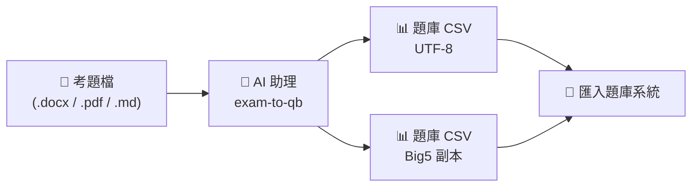

# QB 題庫轉換

> 🏆 本專案「AI 題庫自動轉換 exam-to-qb」榮獲大仁科技大學 115 年度
> **第四屆校務創新創意實踐典範競賽　B 類特優**（2026 年 11 月）

## 這個專案在做什麼？（3 秒看懂）

> **把「老師手上的考題檔」變成「系統吃得下的題庫檔」。**

```
   📄 考題檔                 🤖 交給 AI 助理               📊 題庫 CSV
  Word / PDF / md   ──▶  「請把 xxx 轉成題庫」  ──▶   直接匯入題庫系統
```



### 你只要做三件事
| 步驟 | 動作 | 網頁版 | 本機工具 |
|:--:|------|--------|----------|
| 1️⃣ | 準備考題檔 | 把 `sample.docx` 附加到對話 | `sample.docx` 放在專案資料夾 |
| 2️⃣ | 跟 AI 說一句話 | `請用 exam-to-qb 技能把附件轉成題庫 CSV，類別：資訊安全` | `請把 sample.docx 轉成題庫 題庫/sample.csv` |
| 3️⃣ | 核對後匯入題庫系統 | 下載的 CSV | `題庫/sample.csv` |

第一次使用要先安裝技能，見〈技能安裝與同步〉。

### 它會幫你處理的雜事
- ✅ 認出題型（是非 / 單選 / 複選 / 填充 / 問答）
- ✅ 拆好題目、選項、答案、解說
- ✅ 排成題庫系統要的 27 欄格式
- ✅ 擋下答案缺漏、答案編號超過選項數等格式錯誤（Gemini 網頁版除外）
- ✅ 編碼一律 UTF-8（可另附 Big5 版給舊系統；Gemini 網頁版需自行另存）
- ✅ 可依章節標題填「類別」

### 先用範例練習

根目錄附了一份練習用考題與轉換成果，主題「資訊安全」，共 9 題，五種題型都有：

| 檔案 | 用途 |
|------|------|
| [`sample.docx`](https://github.com/RelerChenTajen/Tools_QB/raw/main/sample.docx) | 範例考題，轉換的來源 |
| [`sample.csv`](sample.csv) | 轉換成果（UTF-8 無 BOM，類別「資訊安全」） |
| [`sample_big5.csv`](sample_big5.csv) | 轉換成果的 Big5 版 |

下面的操作都以 `sample.docx` 示範。本機工具輸出到 `題庫/sample.csv`，網頁版則下載產生的檔案，再與根目錄的 `sample.csv` 對照。
各題的正確答案見[範例對照表](web/README.md#範例對照表)。

### 三家 AI、兩種用法

本專案的技能依循 [Agent Skills 開放標準](https://agentskills.io) 撰寫，同一套規則可用在三家主流 AI。轉換引擎為 Python（無第三方套件），Windows／macOS／Linux 皆可執行；Gemini 網頁版不能執行技能裡的程式，改用由正本產生的純文字版。

| 廠商 | 網頁版 | 本機工具（命令列） |
|------|--------|--------------------|
| Anthropic | [**Claude Web**](web/claude-web.md)：免費帳號可用 | **Claude Code** |
| OpenAI | [**ChatGPT Web**](web/chatgpt-web.md)：技能限 Business／Enterprise／Edu／Healthcare，其他方案用附件方式 | **Codex** |
| Google | [**Gemini Web**](web/gemini-web.md)：限滿 18 歲的個人帳號，免費可用；CSV 由 AI 直接寫出，未經 `build.py` 檢查 | **Gemini CLI** |

網頁版比較：

| | Claude Web | ChatGPT Web | Gemini Web |
|---|---|---|---|
| CSV 由誰產生 | `build.py` | `build.py` | AI 直接寫出 |
| 格式錯誤檢查 | 程式檢查 | 程式檢查 | 沒有，要自己核對 |
| Big5 版 | 可直接產生 | 可直接產生 | 用記事本另存 ANSI |
| 實測（2026-11-25） | 尚未實測 | 尚未實測 | ✅ `sample.docx` 產出與 `sample.csv` 內容相同，可匯入題庫系統 |

- **有個人 Google 帳號**：Gemini Web 已實測可用，匯入前請逐題核對。
- **重要考試或需要格式檢查**：用 Claude Web 或本機工具。
- **要批次處理或維護本專案**：用本機工具，見〈技能安裝與同步〉。

完整的比較與測試紀錄見[網頁版總覽](web/README.md)。

不綁單一廠商——換工具不必重做，轉換規則與輸出格式都相同。

技能正本就在本 repo 的 [`skill/exam-to-qb/`](skill/exam-to-qb/)，本機工具 clone 後執行一行安裝指令，網頁版上傳 ZIP 即可（見〈技能安裝與同步〉）。

---

# 詳細使用說明

把使用者提供的題目檔案（Word / PDF / 純文字等）轉成可匯入的題庫 CSV，並可同時輸出 Big5 副本。
背後由 `exam-to-qb` skill 自動處理，可用於 Claude Code、OpenAI Codex、Gemini CLI，以及 Claude、ChatGPT、Gemini 網頁版（安裝方式見下方〈技能安裝與同步〉）。

## 編碼約定
- 主檔一律 **UTF-8 (no BOM)**。
- Big5 副本命名規則：副檔名前加 `_big5`，例如 `sample.csv` → `sample_big5.csv`。
- Big5 字集較小，`build.py` 轉換時會自動把 `≥`→`≧`、`≤`→`≦`；若仍有無法表示的字元會以 `?` 寫入並提出警告。

## 如何下 prompt

**網頁版**（先附加考題檔）：

| AI | 輸入 |
|----|------|
| Claude、ChatGPT | `請使用 exam-to-qb 技能，把附件轉成題庫 CSV，類別填「資訊安全」，並產生 Big5 版。` |
| Gemini | 輸入 `@` 選 `exam-to-qb`，再輸入 `請把附件轉成題庫 CSV，類別：資訊安全` |

ChatGPT 附件方式、各平台的修改與補救說法，見各自的[操作說明](web/README.md)。

**本機工具**：用以下範例。

### 1. 轉換新題目檔（最常用）
```
請把 sample.docx 轉成題庫 題庫/sample.csv
```
會自動詢問：①是否填入「類別」欄、②是否要 Big5 副本。
在 Claude Code 也可用斜線指令：
```
/exam-to-qb sample.docx
```

### 2. 一次把條件講清楚（省去被反問）
```
請把 sample.docx 轉成題庫 題庫/sample.csv，類別填「資訊安全」，並一併產生 Big5 版
```
```
把 sample.docx 轉成題庫 題庫/sample.csv，不需要類別，也不用 Big5
```

### 3. 只要 Big5 副本 / 補轉舊檔
```
請把 題庫/sample.csv 另存一份 Big5 格式
```

### 4. 修訂已轉好的題庫
```
請修訂 題庫/sample.csv，把類別欄改成「資安素養」
```
```
題庫/sample.csv 第 4 題答案改成 (B)，並更新解說
```

### 5. 其他加工（CSV 完成後再要求）
```
把 題庫/sample.csv 也輸出成 Excel (.xlsx)
```
```
把 題庫/sample_big5.csv 轉回 UTF-8
```

## 下 prompt 小訣竅
- 講明**來源檔名與輸出檔名**（如 `sample.docx → 題庫/sample.csv`），不必猜。
- **先決定的事先講**（類別名稱、要不要 Big5），可省去中途反問。
- 沒指定時預設：UTF-8 (no BOM)，並主動詢問類別與 Big5。
- 支援來源格式：`.docx`、`.pdf`、`.txt`、`.md`、`.csv`（舊版 `.doc` 二進位檔建議先另存成 `.docx`）。

## 技能安裝與同步

技能本體就放在本 repo 的 [`skill/exam-to-qb/`](skill/exam-to-qb/)，是**唯一正本**；本機工具由安裝腳本佈署到家目錄，網頁版則上傳由正本打包的 ZIP。

### 網頁版：上傳 ZIP

| AI 網頁版 | 上傳用的安裝檔（不要解壓縮） | 安裝步驟 |
|-----------|---------------------------|----------|
| Claude | [`exam-to-qb.zip`](https://github.com/RelerChenTajen/Tools_QB/raw/main/web/dist/exam-to-qb.zip) | [claude-web.md](web/claude-web.md) |
| ChatGPT | 同上 | [chatgpt-web.md](web/chatgpt-web.md) |
| Gemini | [`exam-to-qb-gemini.zip`](https://github.com/RelerChenTajen/Tools_QB/raw/main/web/dist/exam-to-qb-gemini.zip) | [gemini-web.md](web/gemini-web.md) |

不要用 GitHub 的「Download ZIP」，那是整個專案，不是技能安裝檔。
ChatGPT 的 Free、Go、Plus、Pro 用[附件方式](web/chatgpt-web.md#方式-b附件)。

**安裝後先驗證**：用 `sample.docx` 轉一次，CSV 第一列應以 `version: 4` 開頭。Gemini 若不是，請刪除技能重新建立。

### 本機工具：安裝位置

| 路徑 | 供哪些工具讀取 |
|------|---------------|
| `skill/exam-to-qb/`（本 repo） | 正本，版控於此 |
| `~/.claude/skills/exam-to-qb/` | Claude Code |
| `~/.agents/skills/exam-to-qb/` | OpenAI Codex、Gemini CLI（兩家共用的互通路徑） |

> Claude Code 只掃 `~/.claude/skills/` 與專案內的 `.claude/skills/`，不讀 `~/.agents/skills/`，所以要佈署到兩個位置。

### 本機工具：安裝（新電腦或其他教師）

```bash
git clone https://github.com/RelerChenTajen/Tools_QB.git
cd Tools_QB/skill
```

```powershell
# Windows
.\install.ps1             # 複製模式
.\install.ps1 -Link       # 目錄連結模式（git pull 後自動更新，免重裝）
.\install.ps1 -WhatIf     # 只顯示會做什麼，不實際動作
```

```bash
# macOS / Linux
./install.sh              # 複製模式
./install.sh --link       # 符號連結模式
./install.sh --dry-run    # 只顯示會做什麼
```

兩種模式的差別：

| 模式 | 優點 | 代價 |
|------|------|------|
| **複製**（預設） | 最保險，任何環境都可用 | 改了 repo 的技能要重跑安裝腳本 |
| **連結** | `git pull` 後立即生效，不會有版本漂移 | 需要 repo 一直放在原位置；Windows 用 `mklink /J`，免系統管理員權限 |

### 本機工具：驗證安裝成功

```bash
python ~/.agents/skills/exam-to-qb/build.py --help
```

在 Claude Code 裡也可以用 `/skills` 指令確認 `exam-to-qb` 已載入。

### 修改技能的流程

1. 改 `skill/exam-to-qb/` 底下的檔案（正本）
2. commit + push
3. 複製模式：重跑安裝腳本；連結模式：不必做任何事
4. 網頁版：執行 `python web/pack.py` 重新打包並 commit + push，再通知使用者重新上傳（網頁版不會自動更新；Gemini 請先刪除舊技能）

### 本機工具：技能目錄對照

| 工具 | 個人層級 | 專案層級 |
|------|---------|---------|
| Claude Code | `~/.claude/skills/` | `.claude/skills/` |
| OpenAI Codex | `~/.agents/skills/` | `.agents/skills/` |
| Gemini CLI | `~/.gemini/skills/` 或 `~/.agents/skills/` | `.gemini/skills/` 或 `.agents/skills/` |

## 直接用指令跑引擎（不透過 AI）

題目已整理成 TSV 時，可以略過 AI 直接跑引擎。以下在 repo 根目錄執行，以技能附的 [`rows.sample.tsv`](skill/exam-to-qb/examples/rows.sample.tsv)（12 題）示範：

```bash
# 從 docx 取出純文字
python skill/exam-to-qb/extract.py sample.docx -o 題庫/sample.txt

# 全部同一個類別
python skill/exam-to-qb/build.py --tsv skill/exam-to-qb/examples/rows.sample.tsv --out 題庫/my_exam.csv --category "綠色能源" --big5

# 與成果檔對照，沒有任何輸出就是完全相同
git diff --no-index skill/exam-to-qb/examples/exam01.sample.csv 題庫/my_exam.csv
```

其他用法：

```bash
# 各題依章節填不同類別（.cats 一行一個，行數需等於題數）
python skill/exam-to-qb/build.py --tsv rows.tsv --out 題庫/my_exam.csv --category-file rows.cats --big5

# 題目檢查有錯時會全部列出並停止；確定要照樣輸出才加 --allow-invalid
python skill/exam-to-qb/build.py --tsv rows.tsv --out 題庫/my_exam.csv --allow-invalid
```

## 題庫 CSV 格式速查（27 欄）
| 欄 | 名稱 | 說明 |
|----|------|------|
| 1 | 題組 | 留空（題庫不支援） |
| 2 | 類別 | 可選；匯入線上測驗時不支援，僅題庫內分類 |
| 3 | 題型 | 1=是非 2=單選 3=複選 4=填充 5=問答 |
| 4 | 題目 | 題幹；填充題把答案內嵌成 `[*答案*]` |
| 5 | 答案 | 是非:1=是/2=否；單選:選項編號；複選:`1,2,4`；填充:留空；問答:參考答案 |
| 6 | 解說 | 可空 |
| 7 | 難易度 | 1=容易 2=適中 3=困難 |
| 8 | 選項1 | 選擇題=選項文字；填充題=1不分大小寫/2區分大小寫 |
| 9 | 選項2 | 選擇題=選項文字；填充題=1不考慮順序/2需考慮順序 |
| 10–27 | 選項3–20 | 其餘選項 |

## 目錄結構
```
QB/
├── README.md                 本說明
├── sample.docx               範例考題（資訊安全，9 題）
├── sample.csv                範例轉換成果（UTF-8 no BOM）
├── sample_big5.csv           範例轉換成果 Big5 版
├── template/                 題庫系統的 CSV 範本 exam.csv 與 Big5 版
├── skill/                    技能正本（exam-to-qb）與安裝腳本
├── web/                      網頁版（Claude／ChatGPT／Gemini）
│   ├── README.md             總覽、比較與共用檢查項目
│   ├── claude-web.md         Claude 安裝與操作
│   ├── chatgpt-web.md        ChatGPT 安裝與操作
│   ├── gemini-web.md         Gemini 安裝與操作
│   ├── gemini/               Gemini 專用技能範本
│   ├── pack.py               由正本打包 ZIP
│   ├── dist/                 安裝檔 ZIP
│   └── archive/              原始稿（僅供參考，請勿用來安裝）
├── 題庫/                     轉換後的題庫、原始題目檔與中繼檔，新轉換的一律放這裡
│                             （只有 exam* 開頭的檔案入庫，其餘僅保留本機，見 .gitignore）
└── 第四屆校務創新創意實踐典範競賽/  競賽用工作目錄（不入庫）
```
