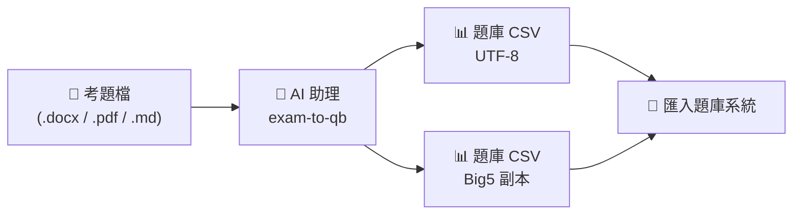

# QB 題庫轉換

> 🏆 本專案「AI 題庫自動轉換 exam-to-qb」榮獲大仁科技大學 115 年度
> **第四屆校務創新創意實踐典範競賽　B 類特優**（2026 年 11 月）

## 這個專案在做什麼？（3 秒看懂）

> **把「老師手上的考題檔」變成「系統吃得下的題庫檔」。**

```
   📄 考題檔                 🤖 交給 AI 助理               📊 題庫 CSV
  Word / PDF / md   ──▶  「請把 xxx 轉成題庫」  ──▶   直接匯入題庫系統
```



### 你只要做三件事
| 步驟 | 動作 | 例子 |
|:--:|------|------|
| 1️⃣ | 把考題檔放進 `題庫/`（網頁版：附加到對話） | `題庫/exam02.docx` |
| 2️⃣ | 跟 AI 說一句話 | `請把 題庫/exam02.docx 轉成題庫` |
| 3️⃣ | 核對後，把產生的 CSV 匯入系統 | `題庫/exam02.csv` |

### 它會幫你處理的雜事
- ✅ 認出題型（是非 / 單選 / 複選 / 填充 / 問答）
- ✅ 拆好題目、選項、答案、解說
- ✅ 排成題庫系統要的 27 欄格式
- ✅ 編碼一律 UTF-8（另附 Big5 版給舊系統）
- ✅ 可依章節標題填「類別」

### 目前已完成的題庫
| 題庫 | 題數 | 位置 |
|------|:--:|------|
| 資訊圖表（範例） | 12 | `題庫/exam01.csv` |
| AI 基礎概論 第 1 章 | 20 | `題庫/AI_chap1.csv` |
| AI 應用 第 3 章 | 40 | `題庫/AI_CH03.csv` |
| 低碳生活與氣候公約 | 30 | `題庫/低碳生活與氣候公約測驗.csv` |
| SDGs 永續發展 | 30 | `題庫/SDGs 永續發展測驗題庫.csv` |
| 2050 淨零排放 | 20 | `題庫/2050淨零排放測驗.csv` |
| 2050 淨零排放（5.1／5.2） | 40 | `題庫/2050淨零排放測驗 (1).csv` |
| 農業淨零政策 | 25 | `題庫/農業淨零政策.csv` |
| 綠色能源 | 45 | `題庫/七_綠色能源考題.csv` |
| 碳足跡與溫室氣體 | 25 | `題庫/八_碳足跡與溫室氣體.csv` |
| **合計 10 份** | **287** | |

> 只有 `exam*` 範例檔入庫，其餘題庫僅保留在本機。

### 三家 AI、兩種用法

本專案的技能依循 [Agent Skills 開放標準](https://agentskills.io) 撰寫，同一份技能可用在三家主流 AI。轉換引擎為 Python（無第三方套件），Windows／macOS／Linux 皆可執行。

| 廠商 | 網頁版（不必安裝程式） | 本機工具（命令列） |
|------|------------------------|--------------------|
| Anthropic | [**Claude Web**](web/claude-web.md)：免費帳號可用 | **Claude Code** |
| OpenAI | [**ChatGPT Web**](web/chatgpt-web.md)：技能限 Business／Enterprise／Edu／Healthcare，其他方案用附件方式 | **Codex** |
| Google | [**Gemini Web**](web/gemini-web.md)：技能限滿 18 歲的個人帳號，學校帳號尚未開放 | **Gemini CLI** |

- **一般教師**：建議從網頁版開始，先看[網頁版總覽與比較](web/README.md)。
- **要批次處理或維護本專案**：用本機工具，見〈技能安裝與同步〉。

> 網頁版的安裝檔已測試與正本輸出一致；三家網頁的實際上傳安裝尚未實測（2026-11-24）。

不綁單一廠商——換工具不必重做，轉換規則與輸出格式都相同。
技能正本就在本 repo 的 [`skill/exam-to-qb/`](skill/exam-to-qb/)，本機工具 clone 後執行一行安裝指令，網頁版上傳 ZIP 即可（見〈技能安裝與同步〉）。

---

# 詳細使用說明

把使用者提供的題目檔案（Word / PDF / 純文字等）轉成可匯入的題庫 CSV，並可同時輸出 Big5 副本。
背後由 `exam-to-qb` skill 自動處理，可用於 Claude Code、OpenAI Codex、Gemini CLI，以及 Claude、ChatGPT、Gemini 網頁版（安裝方式見下方〈技能安裝與同步〉）。

## 編碼約定
- 主檔一律 **UTF-8 (no BOM)**。
- Big5 副本命名規則：副檔名前加 `_big5`，例如 `exam02.csv` → `exam02_big5.csv`。
- Big5 字集較小，轉換時會自動把 `≥`→`≧`、`≤`→`≦`；若仍有無法表示的字元會以 `?` 寫入並提出警告。

## 如何下 prompt

以下範例適用本機工具。網頁版請先附加檔案，把檔名改說成「附件」，並加上「請使用 exam-to-qb 技能」；完整範本見[網頁版總覽](web/README.md#提示詞範本)。

### 1. 轉換新題目檔（最常用）
```
請把 exam02.docx 轉成題庫 exam02.csv
```
會自動詢問：①是否填入「類別」欄、②是否要 Big5 副本。
在 Claude Code 也可用斜線指令：
```
/exam-to-qb exam02.docx
```

### 2. 一次把條件講清楚（省去被反問）
```
請把 exam02.docx 轉成題庫 exam02.csv，類別填「綠色能源」，並一併產生 Big5 版 exam02_big5.csv
```
```
把 exam03.pdf 轉成題庫，不需要類別，也不用 Big5
```

### 3. 只要 Big5 副本 / 補轉舊檔
```
請把 exam01.csv 另存一份 Big5 格式
```

### 4. 修訂已轉好的題庫
```
請修訂 exam02.csv，把類別欄改成「資訊安全」
```
```
exam02.csv 第 5 題答案改成 (C)，並更新解說
```

### 5. 其他加工（CSV 完成後再要求）
```
把 exam02.csv 也輸出成 Excel (.xlsx)
```
```
把 exam02_big5.csv 轉回 UTF-8
```

## 下 prompt 小訣竅
- 講明**來源檔名與輸出檔名**（如 `exam02.docx → exam02.csv`），不必猜。
- **先決定的事先講**（類別名稱、要不要 Big5），可省去中途反問。
- 沒指定時預設：UTF-8 (no BOM)，並主動詢問類別與 Big5。
- 支援來源格式：`.docx`、`.pdf`、`.txt`、`.md`、`.csv`（舊版 `.doc` 二進位檔建議先另存成 `.docx`）。

## 技能安裝與同步

技能本體就放在本 repo 的 [`skill/exam-to-qb/`](skill/exam-to-qb/)，是**唯一正本**；本機工具由安裝腳本佈署到家目錄，網頁版則上傳由正本打包的 ZIP。

### 網頁版：上傳 ZIP

| AI 網頁版 | 安裝檔（下載後不要解壓縮） | 安裝步驟 |
|-----------|---------------------------|----------|
| Claude | [`exam-to-qb.zip`](https://github.com/RelerChenTajen/Tools_QB/raw/main/web/dist/exam-to-qb.zip) | [claude-web.md](web/claude-web.md) |
| ChatGPT | 同上 | [chatgpt-web.md](web/chatgpt-web.md) |
| Gemini | [`exam-to-qb-gemini.zip`](https://github.com/RelerChenTajen/Tools_QB/raw/main/web/dist/exam-to-qb-gemini.zip) | [gemini-web.md](web/gemini-web.md) |

不要用 GitHub 的「Download ZIP」，那是整個專案，不是技能安裝檔。

### 本機工具：安裝位置

| 路徑 | 供哪些工具讀取 |
|------|---------------|
| `skill/exam-to-qb/`（本 repo） | 正本，版控於此 |
| `~/.claude/skills/exam-to-qb/` | Claude Code |
| `~/.agents/skills/exam-to-qb/` | OpenAI Codex、Gemini CLI（兩家共用的互通路徑） |

> Claude Code 只掃 `~/.claude/skills/` 與專案內的 `.claude/skills/`，不讀 `~/.agents/skills/`，所以要佈署到兩個位置。

### 本機工具：安裝（新電腦或其他教師）

```bash
git clone https://github.com/RelerChenTajen/Tools_QB.git
cd Tools_QB/skill
```

```powershell
# Windows
.\install.ps1             # 複製模式
.\install.ps1 -Link       # 目錄連結模式（git pull 後自動更新，免重裝）
.\install.ps1 -WhatIf     # 只顯示會做什麼，不實際動作
```

```bash
# macOS / Linux
./install.sh              # 複製模式
./install.sh --link       # 符號連結模式
./install.sh --dry-run    # 只顯示會做什麼
```

兩種模式的差別：

| 模式 | 優點 | 代價 |
|------|------|------|
| **複製**（預設） | 最保險，任何環境都可用 | 改了 repo 的技能要重跑安裝腳本 |
| **連結** | `git pull` 後立即生效，不會有版本漂移 | 需要 repo 一直放在原位置；Windows 用 `mklink /J`，免系統管理員權限 |

### 本機工具：驗證安裝成功

```bash
python ~/.agents/skills/exam-to-qb/build.py --help
```

在 Claude Code 裡也可以用 `/skills` 指令確認 `exam-to-qb` 已載入。

### 修改技能的流程

1. 改 `skill/exam-to-qb/` 底下的檔案（正本）
2. commit + push
3. 複製模式：重跑安裝腳本；連結模式：不必做任何事
4. 網頁版：執行 `python web/pack.py` 重新打包並 commit + push，再通知使用者重新上傳（網頁版不會自動更新）

### 本機工具：技能目錄對照

| 工具 | 個人層級 | 專案層級 |
|------|---------|---------|
| Claude Code | `~/.claude/skills/` | `.claude/skills/` |
| OpenAI Codex | `~/.agents/skills/` | `.agents/skills/` |
| Gemini CLI | `~/.gemini/skills/` 或 `~/.agents/skills/` | `.gemini/skills/` 或 `.agents/skills/` |

## 直接用指令跑引擎（不透過 AI）

題目已整理成 TSV 時，可以略過 AI 直接跑引擎：

```bash
cd ~/.agents/skills/exam-to-qb

# 全部同一個類別
python build.py --tsv rows.tsv --out exam02.csv --category "綠色能源" --big5

# 各題依章節填不同類別（.cats 一行一個，行數需等於題數）
python build.py --tsv rows.tsv --out exam02.csv --category-file rows.cats --big5

# 從 docx 取出純文字
python extract.py 題目.docx -o 題目.txt
```

## 題庫 CSV 格式速查（27 欄）
| 欄 | 名稱 | 說明 |
|----|------|------|
| 1 | 題組 | 留空（題庫不支援） |
| 2 | 類別 | 可選；匯入線上測驗時不支援，僅題庫內分類 |
| 3 | 題型 | 1=是非 2=單選 3=複選 4=填充 5=問答 |
| 4 | 題目 | 題幹；填充題把答案內嵌成 `[*答案*]` |
| 5 | 答案 | 是非:1=是/2=否；單選:選項編號；複選:`1,2,4`；填充:留空；問答:參考答案 |
| 6 | 解說 | 可空 |
| 7 | 難易度 | 1=容易 2=適中 3=困難 |
| 8 | 選項1 | 選擇題=選項文字；填充題=1不分大小寫/2區分大小寫 |
| 9 | 選項2 | 選擇題=選項文字；填充題=1不考慮順序/2需考慮順序 |
| 10–27 | 選項3–20 | 其餘選項 |

## 目錄結構
```
QB/
├── README.md                 本說明
├── exam.csv                  題庫範本（UTF-8 no BOM）
├── exam_big5.csv             範本 Big5 版
├── skill/                    技能正本（exam-to-qb）與安裝腳本
├── web/                      網頁版（Claude／ChatGPT／Gemini）
│   ├── README.md             總覽、比較與共用檢查項目
│   ├── claude-web.md         Claude 安裝與操作
│   ├── chatgpt-web.md        ChatGPT 安裝與操作
│   ├── gemini-web.md         Gemini 安裝與操作
│   ├── pack.py               由正本打包 ZIP
│   ├── dist/                 安裝檔 ZIP
│   └── archive/              原始稿（僅供參考，請勿用來安裝）
├── 題庫/                     已完成的題庫、原始題目檔與中繼檔
                              （只有 exam* 開頭的範例檔入庫，其餘僅保留本機，見 .gitignore）
└── 第四屆校務創新創意實踐典範競賽/  競賽用工作目錄（不入庫）
```

## 題庫/ 目前檔案
| 檔案 | 編碼 | 說明 |
|------|------|------|
| `exam.docx` | — | exam01 原始題目檔 |
| `exam_text.txt` | UTF-8 | exam01 抽取文字 |
| `rows.tsv` | UTF-8 | exam01 TSV 中繼檔（本機） |
| `exam01.csv` | UTF-8 (no BOM) | 範例題庫（資訊圖表，12 題，類別=綠色能源） |
| `exam01_big5.csv` | Big5 | 範例題庫 Big5 版 |
| `AI 基礎概論測驗.md` | UTF-8 | AI_chap1 原始題目檔（本機） |
| `AI_chap1.csv` | UTF-8 (no BOM) | AI 基礎概論 第 1 章（20 題單選，類別=1-1～1-4 各節標題）（本機） |
| `AI_chap1_big5.csv` | Big5 | AI_chap1 Big5 版（本機） |
| `AI_CH03.md` | UTF-8 | AI_CH03 原始題目檔（本機） |
| `AI_CH03_rows.tsv` / `AI_CH03_rows.cats` | UTF-8 | AI_CH03 TSV 中繼檔與各題類別（本機） |
| `AI_CH03.csv` | UTF-8 (no BOM) | AI 應用 第 3 章（40 題單選，類別=3-1～3-4 各節標題）（本機） |
| `AI_CH03_big5.csv` | Big5 | AI_CH03 Big5 版（本機） |
| `低碳生活與氣候公約測驗.docx` | — | 低碳生活與氣候公約測驗 原始題目檔（本機） |
| `低碳生活與氣候公約測驗.csv` | UTF-8 (no BOM) | 低碳生活與氣候公約（30 題單選，類別=1.1 / 1.2 各節標題）（本機） |
| `低碳生活與氣候公約測驗_big5.csv` | Big5 | 低碳生活與氣候公約測驗 Big5 版（本機） |
| `SDGs 永續發展測驗題庫.docx` | — | SDGs 永續發展 原始題目檔（本機） |
| `SDGs 永續發展測驗題庫.csv` | UTF-8 (no BOM) | SDGs 永續發展（30 題單選，類別=2.1 / 2.2 各節標題）（本機） |
| `SDGs 永續發展測驗題庫_big5.csv` | Big5 | SDGs 永續發展 Big5 版（本機） |
| `2050淨零排放測驗.md` | UTF-8 | 2050 淨零排放 原始題目檔（本機） |
| `2050淨零排放測驗.csv` | UTF-8 (no BOM) | 2050 淨零排放（20 題單選，無解說，類別=2050淨零排放）（本機） |
| `2050淨零排放測驗 (1).md` | UTF-8 | 2050 淨零排放 5.1／5.2 原始題目檔（本機） |
| `2050淨零排放測驗 (1).csv` | UTF-8 (no BOM) | 2050 淨零排放（40 題單選，無解說，類別=2050淨零排放-5.1／-5.2）（本機） |
| `農業淨零政策.md` | UTF-8 | 農業淨零政策 原始題目檔（本機） |
| `農業淨零政策.csv` | UTF-8 (no BOM) | 農業淨零政策（25 題單選，類別=農業淨零政策）（本機） |
| `七_綠色能源考題.md` | UTF-8 | 綠色能源 原始題目檔（本機） |
| `七_綠色能源考題.csv` | UTF-8 (no BOM) | 綠色能源（45 題單選，類別=綠色能源）（本機） |
| `八_碳足跡與溫室氣體.md` | UTF-8 | 碳足跡與溫室氣體 原始題目檔（本機） |
| `八_碳足跡與溫室氣體.csv` | UTF-8 (no BOM) | 碳足跡與溫室氣體（25 題單選，類別=碳足跡與溫室氣體）（本機） |

新轉換的題庫請一律輸出到 `題庫/`，例如：`請把 題庫/exam02.docx 轉成題庫 題庫/exam02.csv`。
